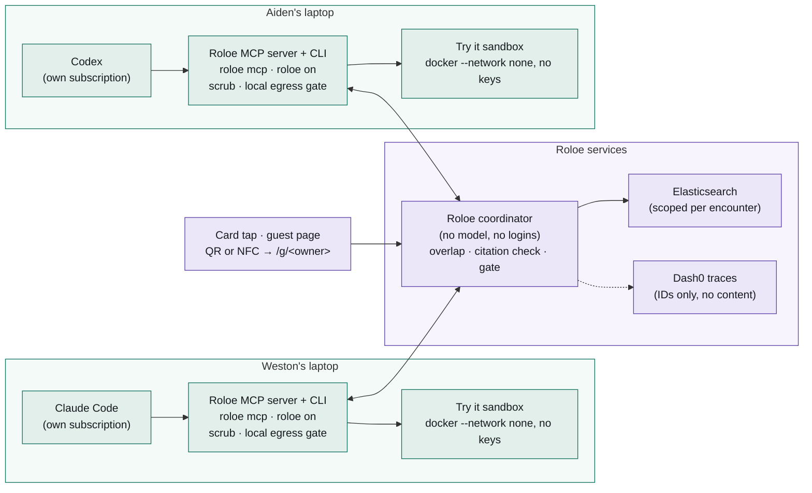

# Roloe

**A business card that brings your work. Scan, and the person in front of you gets the help you already have.**

## Run your card in two steps

1. **Once, on your laptop** (Node 22, git, and Claude Code or Codex logged in on your own account):

   ```bash
   git clone https://github.com/WestonBDev/roloe ~/roloe && cd ~/roloe && npm ci && node bin/roloe.mjs join --url <coordinator URL> --owner <short-name> --name "<Your Name>" --project <the project you're working on today>
   ```

2. **In your assistant, opened in that project, say once:**

   > Wait for Roloe meetings: call roloe_wait_for_tap, follow the instructions it returns, post your findings, then call it again. Keep going until I say stop.

People meet you by scanning your QR: open `/q/<short-name>` on your phone or screen. Check exactly what your card shares with `node bin/roloe.mjs show`, and keep names, clients or topics off it for good with `node bin/roloe.mjs off-limits add "<term>"`.

Built during the WeMakeDevs Cloud Native Hackathon, November 9, 2026. AI coding assistants (Claude Code and Codex) were used; I can explain every part of the architecture and the decisions behind it.

> The person next to you already fixed the thing you're stuck on. Neither of you will find out.

Two people tap cards. Each person's **own** assistant (Claude Code, Codex, or any MCP client) reads the overlapping parts of the other person's shared work and returns at most three findings each way. Each finding is credited to a real moment in the giver's work and quotes the giver's own words. The recipient sees the literal diff, approves it, and **Try it** runs their tests in a container with no network. The giver gets a thank-you with the real test count.

Roloe's coordinator **runs no model and never holds anyone's login or token**. Each person's assistant does the reading on that person's own subscription.

## How it was built

- **Test-first.** From the card CLI onward, every feature landed as a failing test commit (`test(red): …`) followed by the commit that makes it pass (`feat(green): …`). The first scrubber, gate and indexer tests were written right after that code, before TDD was adopted; their commit says so. `git log --oneline` shows the pairs.
- **Live or recorded.** Anything recorded rather than live during the demo is listed under [Live and recorded](#live-and-recorded).

## How it works



Teal: each person's own machine and subscription. Purple: Roloe services, no model, no credentials. The same diagram is served at `/how` for a projector.

1. **One switch.** `roloe on` indexes today's work for one project: the owner's own typed messages and the assistant's prose from today's Claude Code and Codex sessions (never tool output, never other sessions' briefs), tracked text files in ~50-line chunks, and the last 25 commits. Everything is scrubbed for secret shapes on the owner's machine and **again** on arrival. `roloe show` (or `/me/<you>`) prints exactly what is shared; anything can be kept private.
2. **Tap.** Scanning a card's QR opens `/g/<owner>`. With your own card on the phone it offers "Tap as you"; otherwise it's the zero-install guest path. At the tap the coordinator copies both cards into a new encounter in Elasticsearch, mints that encounter's key, and precomputes the overlap both ways (about 40 of the giver's passages as queries against the recipient's, reciprocal rank fusion, top 8 with 3 slots kept for files so a finding can carry a code change).
3. **Sealed lines.** Each person may seal one line about what they expect. The browser sends only SHA-256(`nonce|line`); the line opens when the findings land.
4. **Findings.** Each assistant calls `roloe_pull` (or is woken by the tap), reads its slice, and posts at most three findings with `roloe_post_findings`. The **local egress gate** on the giver's machine blocks anything containing a value the scrubber removed from their work. The coordinator then drops, in code, any finding whose citation doesn't resolve to the giver's passage inside this encounter, whose quote isn't verbatim, whose `about` isn't the recipient's, whose change leaves the project, or that fails the gate.
5. **Try it.** `roloe try` runs on the recipient's laptop: it copies the project, applies the edits (each must match exactly once), shows the literal `git diff` on `127.0.0.1:7421`, and after approval installs dependencies from the lockfile, then runs the tests with `--network none --read-only`, no environment and no home mount. Green means exit 0 **and** at least one test ran. Only status and counts go to the coordinator.
6. **Thank-you and receipt.** The giver gets "Helped" with the real test count; each side sees which of its passages the other assistant read.
7. **Stop.** Either person can stop: the key is invalidated, the encounter's copies are deleted, and a query with the old key is run to prove it returns 0.

## Sponsor tools, and what each one carries

| Tool | What it does in Roloe |
| --- | --- |
| **Elasticsearch** | The data layer and the privacy boundary. One passage index (`owner_id`, `encounter_id`, `kind`, `speaker`, `ts`, `text`, plus `semantic_text` where an inference endpoint exists). Cards are copied into each encounter with search + `_bulk?refresh=true`. Each encounter gets an API key minted with user credentials whose role descriptor carries document-level security (`query: {term: {encounter_id}}`), so the key alone can't reach anything else. Overlap uses `_msearch`, and the `rrf` retriever over lexical + semantic on licensed clusters. Stop invalidates the key and `_delete_by_query`s the copies. `node scripts/elastic-check.mjs` prints the live scope mode and a raw no-filter proof. |
| **Dash0** | OpenTelemetry from the first route. Every request is a span; every encounter is one trace with `roloe.tap`, `roloe.overlap`, `roloe.seal`, `roloe.pull`, `roloe.findings`, one `roloe.finding.check` per finding, `roloe.try` (with `roloe.time_to_green_ms`), `roloe.probe` and `roloe.stop`. Attributes are IDs, counts, sizes and per-encounter HMACs; the HMAC key is destroyed on stop. Never text. `node scripts/otlp-check.mjs` proves export. |
| **Radar / Argo CD** | `deploy/coordinator.yaml` (non-root, read-only root, all capabilities dropped, seccomp RuntimeDefault) and `argocd/application.yaml` (automated sync, prune, self-heal). Every push to `main` builds the image to GHCR and pins it in `deploy/kustomization.yaml`; Argo CD rolls it into `team-roloe`. |
| **Gitar** | Every feature arrives as a pull request reviewed against `.gitar/review/roloe-invariants.md`: content never in telemetry, no credentials, every read scoped, findings must cite, gate before egress, sandboxed Try it, stop really stops. |

## Setup

Requirements: Node 22, git. For Try it: Docker (on a Mac, `brew install colima docker && colima start`).

### Run a coordinator

```bash
git clone https://github.com/WestonBDev/roloe && cd roloe
npm ci
cp .env.example .env    # optional: Elastic and Dash0 values; without them it uses an in-memory store and a local trace file
npm start               # http://localhost:7420
```

Set `ROLOE_PUBLIC_URL` to the address phones will use, or the QR codes point at localhost. Without `ELASTIC_URL` the coordinator uses the in-memory store behind the same interface (and says so in its log).

### Join in one command (any second person, Claude Code or Codex)

```bash
git clone https://github.com/WestonBDev/roloe ~/roloe && cd ~/roloe && npm ci && node bin/roloe.mjs join --url http://<coordinator> --owner <short-name> --name "<Your Name>" --project <path to today's project>
```

`join` turns your card on and connects whichever of Claude Code and Codex is installed (`claude mcp add --scope user roloe …`, `codex mcp add roloe …`). Then, in your assistant: *"Call roloe_wait_for_tap, then follow its instructions; repeat."*

### Or step by step: put your card on it (each person, on their own laptop)

```bash
git clone https://github.com/WestonBDev/roloe ~/roloe && cd ~/roloe && npm ci
node bin/roloe.mjs on --url http://<coordinator> --owner <short-name> --name "<Your Name>" --project <path to today's project>
node bin/roloe.mjs show     # exactly what is shared
node bin/roloe.mjs me       # your card page (keep this link to yourself: it holds your card key)
```

Your card key and the values the scrubber removed stay in `~/.roloe/<name>.json` (mode 600).

### Connect your own assistant

**Claude Code**

```bash
claude mcp add roloe -- node ~/roloe/bin/roloe.mjs mcp
claude --dangerously-load-development-channels server:roloe   # optional: taps arrive in the open session (research preview)
```

Then, in the session: *"Wait for Roloe taps and answer them."* (or after a tap: *"What do Aiden and I have for each other?"*).

**Codex**

```bash
codex mcp add roloe -- node ~/roloe/bin/roloe.mjs mcp
```

Codex can't be woken from outside, so start a session in your project and say: *"Call roloe_wait_for_tap, then follow its instructions; repeat."* To skip per-call approval prompts, add `default_tools_approval_mode = "approve"` under `[mcp_servers.roloe]` in `~/.codex/config.toml`.

### Meet

```bash
node bin/roloe.mjs tap <their-name>     # or scan their card's QR: /g/<their-name>
node bin/roloe.mjs inbox                # your meeting links
node bin/roloe.mjs try                  # try a finding's change: literal diff, approve, tests with no network
node bin/roloe.mjs stop                 # end it for both sides
node bin/roloe.mjs canary               # the judge beat: a fresh secret in a file that is never shared
```

### Deploy on the Radar cluster (Argo CD)

Every push to `main` builds the image (`.github/workflows/deploy.yaml`, to `ghcr.io/westonbdev/roloe`) and pins it in `deploy/kustomization.yaml`; Argo CD in the team cluster syncs `deploy/` to namespace `team-roloe`, served at https://roloe.cnh.radarhq.io.

```bash
scripts/k8s-secrets.sh    # creates the roloe-elastic and roloe-otel Secrets from your .env; values never enter git
```

Apply `argocd/application.yaml` once (through Radar's MCP server or kubectl) to start the sync. `ROLOE_PUBLIC_URL` (where QR codes point) lives in the Deployment in `deploy/coordinator.yaml`; change it in git and Argo CD rolls the pod. `AGENTS.md` and `.agents/skills/` tell a coding agent how to ship and debug through Radar.

### Tests

```bash
npm test                                            # 38 tests: in-memory store, Docker tests skip if Docker is absent
set -a; . ~/roloe-elastic/es.env; set +a; npm test  # also runs the store contract against a real Elasticsearch
```

## Dash0: traces, counts and the time-to-help SLO

Traces and metrics go to Dash0 over OTLP (`node scripts/otlp-check.mjs` sends one of each and prints whether Dash0 accepted them).

| Metric | Type | Attributes | Used for |
| --- | --- | --- | --- |
| `roloe.meetings` | counter | `kind`: pair, guest, same_person | counts dashboard |
| `roloe.findings` | counter | `outcome`: accepted, dropped, nothing_strong | counts dashboard |
| `roloe.help` | counter | `outcome`: passed, failed, declined, did-not-apply | counts dashboard |
| `roloe.time_to_help` | histogram, seconds, buckets 10…600 incl. **120** | none | **SLO** |
| `roloe.time_to_findings` | histogram, seconds | none | counts dashboard |

**SLO: time to working help.** 90% of meetings that reach a passing Try it get there within 120 s of the tap. Good events are `roloe.time_to_help` observations in the `le=120` bucket; total events are all observations. In Dash0's query builder the series appear under `otel_metric_name="roloe.time_to_help"`; pick the bucket and count series there, as the exact PromQL names depend on Dash0's mapping. The same numbers are on the coordinator's own `/dashboard` page.

## Pages

| Route | Who | What |
| --- | --- | --- |
| `/g/<owner>` | Anyone who scans the card | Paste a link or skip; "Tap as you" if this phone holds your card |
| `/e/<id>?k=` | Each person | Seal or skip, keep talking, findings dealt one at a time, what you each expected, thank-you, receipt, Stop; guests also get the extraction attempt |
| `/stage/<id>?k=` | Projector | Clock to green, sealed lines, one finding per side, Try it line, Prepared before / Read live strip; `&recorded=<id>&rk=<key>` for the labelled fallback after 1:40 (`&cutoff=` seconds to rehearse) |
| `/me/<owner>#<key>` | Card owner | The switch, totals, every shared passage with Keep private |
| `/dashboard` | Anyone | Meetings, help that worked, nothing strong, declined, failed, medians, canaries in telemetry |
| `/how` | Projector | The architecture: each person's own laptop and subscription, and Roloe's services |
| `/c/<owner>` | Print | 85 × 55 mm card, front and back with QR |

## Fallbacks, all labelled

- **Any second person.** `roloe join` works for anyone with Claude Code or Codex, not one particular partner.
- **No second person.** A judge's zero-install tap (`/g/<owner>`: paste a link, a finding lands, then the extraction attempt) runs live with only the owner enrolled.
- **Recorded.** Every meeting keeps its record (times, findings, Try it result). The stage replays one on its own real clock with `&replay=1`, or switches to one automatically at 1:40 with `&recorded=<id>&rk=<stage key>`; either way the screen says **Recorded HH:MM**.
- **Same person, two projects.** As a last resort, `roloe on --owner <you>-two --project <other project> --same-person-as <you>` makes a second card. It needs your first card's key, and every screen labels the pair "same person, two projects".

## Live and recorded

- Live: everything in the demo is live unless the stage shows the **Recorded** label, which appears only if the live cross-read isn't finished at 1:40.
- Recorded runs and their times are listed here before submission.

## Measured today

| Run | Setup | Tap → overlap ready | Prompt → findings posted | Notes |
| --- | --- | --- | --- | --- |
| Smoke, 10:2x | Local Elasticsearch (Basic), fixture partner + Weston's Roloe card | 0.82 s | Codex 22.6 s ("nothing strong"); Claude Code Sonnet via MCP 25.2 s (1 finding with a 3-edit change, accepted) | Assistants launched by hand after the tap, so these aren't tap → findings |
| Try it | Docker via Colima, fixture project | | | deps + tests with `--network none`; the fixture's own `fetch` test proves the network is off |

## Known limits

- **Already-read passages can't be recalled.** Stop deletes the encounter's copies and revokes its key; it can't recall what an assistant already read, which may remain in that person's session history and with their model provider.
- **Scope on Elastic Cloud Serverless and Basic.** Serverless authenticates with an API key, and Elasticsearch refuses to derive a key with privileges from one ("creating derived api keys requires an explicit role descriptor that is empty"); on a Basic license, document-level security is refused. In both cases the coordinator's `encounter_id` filter (applied on every read in every mode) carries scope, and the stage says which mode is live.
- **One replica.** The coordinator holds encounter keys in memory and its records on one volume, so it runs as a single replica; a restart keeps cards and records but ends open encounters' reads. Scaling out needs that state moved into Elasticsearch.
- **The Claude Code channel is a research preview** (`--dangerously-load-development-channels`); without it, the assistant waits on `roloe_wait_for_tap` like Codex.
- **Mobile assistant connectors are untested.** Guests use the browser page.
- **Quotes from code.** When a giver's best passage is code, the quote is code (shown in mono), not their typed words; the label says whose words it is.

## License

Apache-2.0. See [LICENSE](LICENSE).
